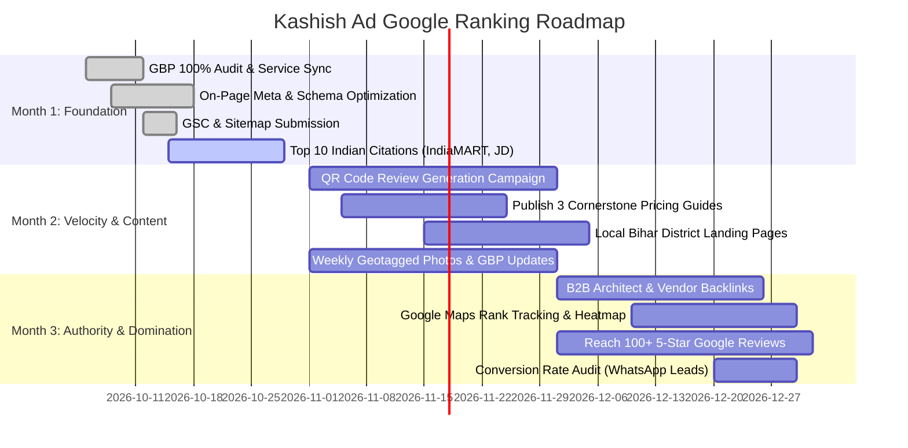

# Kashish Ad® & Patna Signage — Master Google Search Ranking & SEO Plan

**Domain:** `https://kashishad.in` / `https://kashishad.web.app`  
**Business Profile:** Kashish Ad® | Capital Tower, Fraser Road, Patna, Bihar 800001  
**Primary Focus:** Rank #1 on Google Local 3-Pack (Maps) & Google Organic Search (Web) for Printing, Signage, and LED Boards across Patna and Bihar.

---

## 🎯 Executive Summary & The Google Ranking Formula

Google ranks local commercial businesses based on **three core pillars**:
1. **Relevance:** How accurately your business profile and website content match what the user searches.
2. **Prominence (Authority):** Your reputation across the web (Google Reviews, citations on IndiaMART/Justdial, backlinks, brand mentions, social presence).
3. **Distance / Proximity:** How close your workshop/office is to the searcher, amplified by your geo-signals across Patna and Bihar.

To dominate both the **Google Local Map 3-Pack** and **Google Organic Search Results (Page 1)**, this plan executes a synchronized **4-Front Attack**:
- **Front 1: Google Business Profile (GBP) 100% Dominance** (Captures 70%+ of mobile local queries).
- **Front 2: Website Technical & Structured Data SEO** (Schema.org, Core Web Vitals, Crawlability).
- **Front 3: Keyword Architecture & Hyper-Local Content Silos** (Covering Patna neighborhoods & Bihar cities).
- **Front 4: High-Authority Local Citations & Link Acquisition** (IndiaMART, Justdial, B2B supplier backlinks).

---

## 🔑 1. Target Keyword Master Architecture

### A. Tier 1: High-Intent "Money" Keywords (Highest Commercial Value)
*These keywords are searched by business owners, architects, and corporate procurement managers ready to buy.*

| Keyword Query | Search Intent | Target Landing Page | Priority |
| :--- | :--- | :--- | :--- |
| **sign board manufacturer in patna** | Direct Buyer | `/services/led-acrylic-letters` / Homepage | 🔥 Critical |
| **patna signage** | Direct Buyer | Homepage / `/services` | 🔥 Critical |
| **digital printing in patna** | Direct Buyer | `/services/uv-digital` / `/services` | 🔥 Critical |
| **led sign board maker patna** | Direct Buyer | `/services/led-acrylic-letters` | 🔥 Critical |
| **glow sign board patna** | Direct Buyer | `/services/glow-sign-board` | 🔥 High |
| **3d acrylic letters patna** | Direct Buyer | `/services/led-acrylic-letters` | 🔥 High |
| **uv printing in patna** | Commercial Buyer | `/services/uv-digital` | 🔥 High |
| **ss sign board manufacturer patna** | Corporate / Retail | `/services/ss-sign-board` | 🔥 High |
| **flex printing in patna fraser road** | Urgent / Local | `/services/frontlit-flex` | 🔥 High |
| **cnc jali cutting patna** | Interior / Architect | `/services/cnc-laser-jali` | 🔥 High |
| **rollup standee printing patna** | Event / Exhibition | `/services/rollup-standee` | 🔥 Medium |

---

### B. Tier 2: Hyper-Local Neighborhood Keywords (Patna Localities)
*Google tailors results according to micro-locations. Targeting these captures users searching across different parts of Patna.*

- **Fraser Road / Dak Bunglow:** "printing press fraser road patna", "sign board maker near dak bunglow patna", "capital tower printing shop patna".
- **Boring Road / Bailey Road:** "led board makers boring road patna", "acrylic name plate bailey road patna".
- **Kankarbagh:** "flex banner printing kankarbagh", "shop board manufacturer kankarbagh patna".
- **Exhibition Road / Patna Junction:** "digital print shop near patna junction", "exhibition stall flex printing patna".
- **Danapur / Patliputra:** "signage board supplier danapur", "commercial branding patliputra patna".

---

### C. Tier 3: Regional Bihar District Expansion Keywords
*Targeting B2B retail chains opening branches across Bihar.*

- "sign board manufacturer in bihar"
- "led sign board supplier muzaffarpur / gaya / bhagalpur / darbhanga"
- "uv flatbed printing service bihar"
- "wholesale flex banner supplier bihar"

---

### D. Tier 4: Informational & Pricing Intent (High Click-Through & Trust)
- "sign board price per square foot in patna"
- "cost of 3d led letter board patna"
- "acrylic vs acp sign board price difference"
- "uv printing cost per sq ft patna"

---

## 📍 2. Google Business Profile (GBP / Maps 3-Pack) Domination Plan

> **Goal:** Secure the #1 to #3 spot in the Google Map Pack for searches within a 35 km radius of Patna.

### Step 1: Exact Profile Title & Category Optimization
- **Official Name:** `Kashish Ad® - Patna Signage & Digital Printing`  
  *(Note: Keep brand recognizable while naturally associating "Patna Signage" and "Digital Printing").*
- **Primary Category:** `Sign shop` (Must be the exact primary category).
- **Secondary Categories:**
  1. `Commercial printer`
  2. `Digital printing service`
  3. `Print shop`
  4. `Advertising agency`
  5. `Manufacturer`
  6. `Graphic designer`

### Step 2: Complete Service Catalog Sync
- Ensure all 38+ services from `google-profile-services.md` are added inside:
  **Google Business Profile → Edit Profile → Services**.
- Every service entry must have a detailed description containing keywords like:
  *"UV flatbed direct printing on acrylic, glass, wood in Fraser Road, Patna."*

### Step 3: The 60-Day Review Velocity Strategy
*Google ranking algorithm heavily weights review frequency, keywords in reviews, and owner responses.*

1. **Target:** Reach **100+ verified Google Reviews** (currently at ~62 reviews, 4.6★).
2. **Review Generation Process:**
   - Generate a direct review short-link: `https://g.page/r/.../review` or QR code.
   - Place an acrylic counter-stand QR code at the Fraser Road counter: **"Scan to review your print & get 5% off your next order"**.
   - Send automated WhatsApp message immediately after delivery:
     > *"Namaste [Client Name] ji, thank you for choosing Kashish Ad® for your [LED Board / Printing]. Could you take 30 seconds to share your feedback on Google? It helps our local team immensely: [Short Link]"*
3. **Keyword-Rich Customer Reviews:**
   - Encourage clients to mention the specific product: *"Best 3D LED board in Patna"*, *"Fast UV printing in Fraser road"*.
4. **Owner Response Protocol (100% of reviews):**
   - Respond to every review within 24 hours.
   - Include keywords in the response:
     > *"Thank you for trusting Kashish Ad for your showroom 3D LED acrylic letters in Patna! Glad our factory-direct turnaround met your schedule."*

### Step 4: Geotagged Visual Strategy (Photos & Videos)
- Upload **3 to 5 new high-resolution photos every week**:
  - Live machines operating (Industrial UV Roll to Roll, Flatbed, CNC Laser).
  - Finished signboards installed on Patna storefronts.
  - Workshop front at Capital Tower, Fraser Road.
  - Before/After lighting shots of LED 3D letters.
- **Geotagging:** Ensure photos carry EXIF GPS coordinates (`25.6125104, 85.1389093`) or tag location as **Patna, Bihar**.

### Step 5: GBP Posts (Google Updates) Schedule
Post 2 updates every week using Google Business Profile Updates:
- **Monday Post:** Product Spotlight (e.g., "Why 3D Acrylic LED letters last 5+ years in Patna weather").
- **Thursday Post:** Project Showcase (e.g., "Completed new storefront signboard for retail store at Boring Road, Patna").
- Include a clear CTA button: **"Call Now"** (`09308327111`) or **"Learn More"** with a link to the specific website page.

### Step 6: Google Q&A Pre-Seeding
Populate the Questions & Answers section of the GBP profile with the top 10 frequently asked questions:
1. *Q: What is the turnaround time for sign boards at Kashish Ad?*  
   *A: Standard signage takes 2-4 business days. Urgent vinyl and banner printing are dispatched same-day in 4-6 hours at our Fraser Road facility.*
2. *Q: Do you make 3D LED letters with warranty?*  
   *A: Yes, we provide branded waterproof Samsung/LG LED modules with up to 3 years power supply warranty.*
3. *Q: Do you deliver and install signboards across Bihar?*  
   *A: Yes, our installation team serves Patna, Muzaffarpur, Gaya, Darbhanga, Bhagalpur, and all major Bihar districts.*

---

## 💻 3. Website Technical & On-Page SEO Blueprint

### A. Meta Title & Description Formula for Key Pages

| Page Route | Optimized Meta `<title>` (Max 60 chars) | Optimized Meta `<description>` (140-160 chars) |
| :--- | :--- | :--- |
| **`/` (Home)** | `Kashish Ad® \| Patna Signage & LED Sign Board Manufacturer` | `Patna's leading sign board manufacturer & digital printing press. 3D LED acrylic letters, UV printing, SS signs, CNC jali at Fraser Rd. Call 09308327111.` |
| **`/services/led-acrylic-letters`** | `3D LED Acrylic Letters Manufacturer Patna \| Kashish Ad®` | `Get premium 3D LED acrylic letters & glowing sign boards in Patna. Energy-efficient 12V modules, 5+ yrs durability, factory prices. Get instant WhatsApp quote.` |
| **`/services/uv-digital`** | `UV Flatbed & Roll to Roll Printing Patna \| Kashish Ad®` | `Industrial UV printing on acrylic, glass, wood, canvas & flex in Patna. High resolution, scratch-proof, zero fading. Fast 24-hr turnaround at Fraser Road.` |
| **`/services/glow-sign-board`** | `LED Glow Sign Board Maker in Patna \| Shop Front Signs` | `Custom LED glow sign boxes & flex sign boards in Patna. High brightness, aluminum extruded frame, waterproof construction. Free site survey available.` |
| **`/services/ss-sign-board`** | `Stainless Steel & Brass Sign Board Maker Patna \| Kashish Ad®` | `Architectural grade SS 304 & titanium brass sign boards in Patna. Laser cut 3D letters for corporate offices, hospitals & retail stores. Call today.` |
| **`/services/cnc-laser-jali`** | `CNC Laser Jali Cutting in Patna \| ACP, MDF & Metal Panels` | `Precision CNC router & fiber laser jali cutting in Patna for interior elevations, temple backdrops & decorative gates. Custom CAD designs supported.` |
| **`/machinery`** | `Signage Machinery & UV Production Plant Patna \| Kashish Ad®` | `Explore Kashish Ad's 16+ industrial printing & CNC machines in Patna. 3.2m UV Roll-to-Roll, flatbeds, Roland plotters & fiber laser cutters.` |
| **`/contact`** | `Contact Kashish Ad® Patna \| Capital Tower Fraser Road Workshop` | `Visit Kashish Ad at Capital Tower, Fraser Road, Patna or call 09308327111 / 07488984637 for signboard estimates, digital printing and Bihar installation.` |

---

### B. Core Web Vitals & Technical Checklist
1. **LCP (Largest Contentful Paint) < 1.8s:**
   - Serve modern image formats (`.webp` and `.svg`).
   - Preload Google Fonts (`Outfit`, `Caveat`, `Plus Jakarta Sans`) via `preconnect`.
2. **FID / INP (Interactivity) < 100ms:**
   - Keep React hydration lightweight and clean.
3. **CLS (Cumulative Layout Shift) = 0:**
   - Define exact `width` and `height` attributes on all image and icon containers.
4. **Mobile Usability 100%:**
   - 80%+ of signboard searches in Patna happen on mobile devices.
   - Click-to-Call buttons (`tel:09308327111`) and WhatsApp Floating buttons (`wa.me`) must remain sticky and tap-friendly.
5. **Robots.txt & Sitemap.xml:**
   - Ensure `robots.txt` allows all search bots to index `/`, `/services/*`, `/gallery`, `/machinery`, `/contact`.
   - Submit `sitemap.xml` directly to **Google Search Console** and **Bing Webmaster Tools**.

---

### C. Advanced Schema.org Structured Data
The website already has solid Schema injection. We will enhance it with:
1. **`LocalBusiness` + `PrintShop` + `Manufacturer`** (Entity linking with Google Knowledge Graph).
2. **`Product` / `Service` Schema** on each service detail page with `offers` and `priceSpecification`.
3. **`BreadcrumbList` Schema** for smooth Google navigation breadcrumbs in search results.
4. **`FAQPage` Schema** on high-traffic pages (enables large expandable FAQ rich snippets on Google SERPs).

---

## 📝 4. Content Strategy & Topic Clusters (Inbound Lead Generation)

Create 4 high-authority, localized cornerstone articles and calculators on the website to capture searchers at the consideration and pricing stage:

### Article 1: "LED Sign Board Price in Patna: Per Square Foot Cost Guide (2026)"
- **Target Keywords:** `sign board price per square foot in patna`, `led sign board cost patna`, `3d letter board rate bihar`.
- **Content Outline:**
  - Comparison table: 3D Acrylic LED vs. SS 304 Titanium vs. Neon vs. Standard Glow Sign Box.
  - Price brackets (e.g. ₹180 – ₹450 / sq ft for flex/glow sign; ₹80 – ₹250 / inch for 3D letters).
  - What factors influence price (LED brand, transformer warranty, ACP base thickness).
  - Clear CTA to use the **Kashish Ad Online Signboard Calculator**.

### Article 2: "Top 7 Things to Check Before Ordering a Storefront Signboard in Patna"
- **Target Keywords:** `shop board maker patna`, `store signage design patna`.
- **Content Outline:**
  - Weatherproofing against Patna monsoon & extreme summer sun.
  - Electrical safety & 12V IP67 waterproof LED drivers.
  - Municipal signage permissions & building facade guidelines in Patna.
  - Why in-house manufacturing (like Kashish Ad's 16+ machines) beats middlemen.

### Article 3: "UV Printing vs Solvent Vinyl Printing: Which is Better for Your Business?"
- **Target Keywords:** `uv printing vs vinyl printing patna`, `best printing for shop interior`.
- **Content Outline:**
  - Longevity comparison (UV direct curing vs eco-solvent).
  - Material suitability (acrylic, glass, wood vs sticker vinyl).
  - Cost analysis and finish options.

---

## 🔗 5. Local Authority, Citations & Backlink Strategy

### A. High-Authority Indian Business Directories (NAP Consistency)
*NAP = Name, Address, Phone Number. Must match 100% identically across every platform:*
- **Name:** `Kashish Ad®`
- **Address:** `Capital Tower, A-6 & B-16, Fraser Rd, Old Jakkanpur, Lodipur, Patna, Bihar 800001`
- **Phone:** `09308327111` / `07488984637`
- **Website:** `https://kashishad.in`

#### Primary Indian Listing Portals:
1. **IndiaMART:** Create a Verified Supplier Profile for Kashish Ad (Huge domain authority for B2B signage queries).
2. **Justdial Patna:** Claim & verify profile under "Sign Board Manufacturers", "Digital Printing Services".
3. **TradeIndia:** Create listings for industrial signboards, acrylic letters, and UV printing.
4. **Sulekha Patna:** List under "Printing & Signage Contractors".
5. **Bing Places for Business:** Sync directly with Google Business Profile.
6. **Apple Maps Connect:** Claim business location for iOS/Siri users.
7. **Facebook Business Page & Instagram (@kashishadpatna):** Keep bio link pointing to `https://kashishad.in`.

### B. Strategic Local B2B Backlinks
1. **Architect & Interior Designer Alliances:** Partner with Patna interior design studios. Provide signage specs on their blogs/directories in exchange for backlinks.
2. **Commercial Retailers / Clients Portfolio:** Request happy corporate clients (banks, retail chains, hospitals) to credit their signage fabrication to Kashish Ad on their site/social media.
3. **Bihar Chamber of Commerce / MSME Portals:** Register on local Bihar MSME/Udyam directories for government and institutional trust signals.

---

## 📈 6. 30-60-90 Day Execution Roadmap

### 🗓️ Month 1: Technical & Google Business Profile Setup
- [x] Verify exact NAP details across website, footer, and schema metadata.
- [ ] Add all 38 service names & descriptions to Google Business Profile (from `google-profile-services.md`).
- [ ] Claim and complete IndiaMART, Justdial, and TradeIndia profiles.
- [ ] Submit `sitemap.xml` to Google Search Console and verify ownership.
- [ ] Set up Google Analytics 4 (GA4) with custom conversion events for:
  - Phone call clicks (`tel:` links).
  - WhatsApp chat initiations (`wa.me` links).
  - Quote form submissions.

### 🗓️ Month 2: Content Expansion & Review Acceleration
- [ ] Place Google Review QR code standee on Fraser Road counter.
- [ ] Launch post-dispatch WhatsApp review follow-up sequence.
- [ ] Publish the "LED Sign Board Price per Square Foot in Patna" guide on the website.
- [ ] Publish 2 GBP updates per week with real project photos from Boring Road, Fraser Road, and Kankarbagh.
- [ ] Reach 80+ positive reviews on Google.

### 🗓️ Month 3: Regional Dominance & Local Backlink Outreach
- [ ] Build location-focused landing sections for key Bihar hubs (Muzaffarpur, Gaya, Darbhanga).
- [ ] Reach 100+ verified Google Reviews.
- [ ] Monitor Local Falcon / Google Maps grid ranking for "sign board manufacturer patna" and "patna signage".
- [ ] Measure incoming calls and WhatsApp inquiries from organic search; optimize high-performing landing pages.

---

## 📊 Key Performance Indicators (KPIs) to Track

| Metric | Baseline | 30 Days Target | 90 Days Target |
| :--- | :--- | :--- | :--- |
| **Google Local 3-Pack Rank** ("sign board manufacturer patna") | Position #4 - #8 | Top 3 | **#1** |
| **Verified Google Reviews** | 62 reviews | 75 reviews | **100+ reviews (4.7★+)** |
| **Monthly GBP Search Views** | ~1,200 | 2,500 | **5,000+** |
| **Monthly Direct Calls from Google** | ~40 | 80 | **150+** |
| **Monthly WhatsApp Inquiries** | ~35 | 70 | **140+** |
| **Organic Keyword Rankings (Top 10)** | 5 keywords | 15 keywords | **40+ keywords** |
